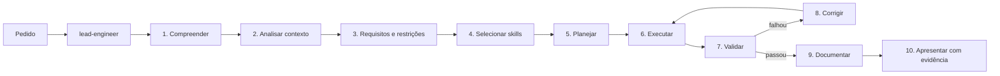
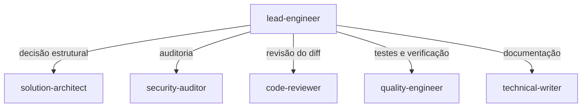

# Prumo

**Skills e agentes de IA para engenharia de software, com método e verificação.**

[](https://github.com/vitin2505/prumo/actions/workflows/validate.yml)
[](LICENSE)

O prumo é o instrumento que mostra se uma parede está reta. Este repositório faz o mesmo pelo trabalho de um assistente de IA: dá a ele o método de um engenheiro experiente e exige prova de que a entrega está certa.

O Prumo reúne **31 skills** e **6 agentes** que cobrem o ciclo de desenvolvimento, do levantamento de requisitos à operação em produção. Todo o conteúdo é original, escrito em português brasileiro e pensado para uso diário em projetos reais.

## Sumário

- [Por que usar](#por-que-usar)
- [Como funciona](#como-funciona)
- [Skills](#skills)
- [Agentes](#agentes)
- [Instalação](#instalação)
- [Como usar as skills](#como-usar-as-skills)
- [Como usar os agentes](#como-usar-os-agentes)
- [Exemplos](#exemplos)
- [Estrutura do repositório](#estrutura-do-repositório)
- [Padrão de qualidade](#padrão-de-qualidade)
- [Como criar uma skill](#como-criar-uma-skill)
- [Como contribuir](#como-contribuir)
- [Roadmap](#roadmap)
- [Licença](#licença)

## Por que usar

Assistentes de IA escrevem código rápido, mas, sem método, pulam o entendimento do problema, ignoram convenções do projeto, esquecem segurança e declaram "pronto" sem testar. O Prumo ataca esses quatro pontos:

| Problema comum | O que o Prumo faz |
| --- | --- |
| Implementar antes de entender | Fluxos que começam por requisitos, contexto e plano |
| Conselho genérico | Skills com passos executáveis, padrões específicos e exemplos |
| Segurança como etapa esquecida | Controles de segurança e de privacidade embutidos nos fluxos de implementação |
| "Deve funcionar" | Critérios de pronto verificáveis e relato obrigatório do que foi e do que não foi verificado |
| Dezenas de skills sobrepostas | Uma skill por competência, com fronteiras declaradas entre elas |
| Contexto desperdiçado | `SKILL.md` curto; o detalhe fica em referências abertas sob demanda |

## Como funciona



- **Skill** é conhecimento operacional sobre um tipo de trabalho. Funciona sozinha, em qualquer ferramenta compatível com o formato de Agent Skills.
- **Agente** é um papel que combina skills. O agente principal, `lead-engineer`, escolhe as skills pela tarefa e pode delegar a especialistas.
- **Fluxo de trabalho** é a sequência de agentes e skills para uma tarefa de ponta a ponta.

Detalhes em [docs/architecture/overview.md](docs/architecture/overview.md).

## Skills

Catálogo completo, gerado a partir dos arquivos: [docs/catalog.md](docs/catalog.md).

| Categoria | Skills |
| --- | --- |
| **Front-end** | `frontend-engineering` |
| **Back-end** | `backend-engineering` · `data-modeling` |
| **Segurança** | `secure-coding` · `security-review` · `threat-modeling` · `privacy-lgpd` |
| **Documentação técnica** | `technical-writing` |
| **APIs e integrações** | `api-design` · `resilient-integrations` |
| **Planejamento e arquitetura** | `requirements-discovery` · `system-architecture` · `implementation-planning` |
| **Stacks e tecnologias** | `stack-typescript-node` · `stack-react-nextjs` · `stack-python-django` · `git-workflow` |
| **Operações e entrega** | `delivery-pipeline` · `observability` · `performance-engineering` |
| **Engenharia de IA** | `prompt-engineering` · `llm-engineering` |
| **Produtividade** | `context-economy` · `skill-authoring` |
| **UI/UX e design** | `interface-design` · `ux-review` |
| **Engenharia de software** | `code-quality` · `testing-strategy` · `code-review` · `debugging` · `delivery-verification` |

Toda skill tem a mesma estrutura: quando usar, fluxo passo a passo, padrões técnicos, o que evitar, critérios de pronto e skills relacionadas. Doze arquivos de referência aprofundam temas como acessibilidade, autenticação e autorização, PostgreSQL, controles por categoria do OWASP Top 10, convenções REST e GraphQL, sistemas distribuídos e tokens de design.

## Agentes

| Agente | Papel | Altera código de produto? |
| --- | --- | --- |
| [`lead-engineer`](agents/core/lead-engineer.md) | Engenheiro líder: entende, planeja, seleciona skills, executa, valida e entrega | Sim |
| [`solution-architect`](agents/specialized/solution-architect.md) | Decisões estruturais com alternativas comparadas e ADRs | Não |
| [`security-auditor`](agents/specialized/security-auditor.md) | Auditoria de segurança independente, somente leitura | Não |
| [`code-reviewer`](agents/specialized/code-reviewer.md) | Revisão independente com apontamentos por severidade | Não |
| [`quality-engineer`](agents/specialized/quality-engineer.md) | Testes automatizados e verificação independente | Apenas testes |
| [`technical-writer`](agents/specialized/technical-writer.md) | Documentação conferida contra o código | Apenas documentação |



Fluxos documentados em [docs/workflows/](docs/workflows/README.md): entrega de funcionalidade, correção de defeito, auditoria de segurança e projeto novo.

## Instalação

Requisitos: uma ferramenta compatível com Agent Skills. As instruções abaixo usam o Claude Code. O instalador por script requer Node.js 18 ou superior.

### Opção 1: como plugin (tudo de uma vez)

Dentro do Claude Code:

```text
/plugin marketplace add vitin2505/prumo
/plugin install prumo@prumo
```

Nesse modo, skills e agentes recebem o prefixo `prumo:` (por exemplo, `/prumo:api-design`).

### Opção 2: pelo instalador (escolhendo o que instalar)

```bash
git clone https://github.com/vitin2505/prumo.git
```

Veja o que está disponível:

```bash
node prumo/scripts/install.mjs --list
```

Instale tudo no projeto atual:

```bash
node prumo/scripts/install.mjs --target . --all --agents
```

Ou apenas o que o projeto precisa:

```bash
node prumo/scripts/install.mjs --target . --skills backend-engineering,api-design,secure-coding,testing-strategy,delivery-verification
```

| Opção | Efeito |
| --- | --- |
| `--target <dir>` | Instala em `<dir>/.claude` (padrão: diretório atual) |
| `--global` | Instala em `~/.claude`, valendo para todos os projetos |
| `--all` / `--category <a,b>` / `--skills <a,b>` | Seleção de skills |
| `--agents` | Instala os agentes |
| `--dry-run` | Mostra o que seria copiado, sem copiar |
| `--force` | Sobrescreve o que já existe no destino |

O instalador nunca sobrescreve sem `--force`.

### Opção 3: cópia manual

Copie a pasta da skill (a pasta inteira, com `references/`) para `.claude/skills/` do projeto, sem a pasta da categoria:

```bash
cp -r prumo/skills/security/secure-coding .claude/skills/secure-coding
```

> **Instale poucas.** A descrição de cada skill instalada ocupa contexto em toda sessão. Prefira o conjunto que o projeto realmente usa. Sugestões por tipo de projeto em [docs/guides/getting-started.md](docs/guides/getting-started.md).

## Como usar as skills

**Acionamento automático.** Peça a tarefa normalmente. A ferramenta compara o pedido com a descrição das skills e carrega a adequada:

```text
Revise a segurança do módulo de pagamentos.
```

**Acionamento explícito.** Chame pelo nome:

```text
/security-review audite src/pagamentos
```

**Para conferir se foi reconhecida**, pergunte quais skills estão disponíveis ou digite `/` e procure o nome.

## Como usar os agentes

**Como agente principal da sessão** (recomendado para tarefas de ponta a ponta; permite delegar aos especialistas):

```bash
claude --agent lead-engineer
```

Com instalação por plugin, o nome é `prumo:lead-engineer`.

**Como subagente**, a partir de uma sessão comum:

```text
Use o agente security-auditor para auditar a pasta src/auth.
```

```text
Use o agente code-reviewer para revisar as alterações pendentes.
```

Em ferramentas sem suporte a subagentes, o corpo de cada arquivo em `agents/` pode ser usado como instrução de sistema.

## Exemplos

| Pedido | O que acontece |
| --- | --- |
| "Quero que os clientes agendem pelo site." | `requirements-discovery` separa problema de solução, levanta as lacunas que mudam o escopo, devolve perguntas com recomendação e escreve requisitos com critérios de aceite |
| "Crie o endpoint de cancelamento de pedido." | `api-design` define o contrato; `backend-engineering` e `secure-coding` guiam a implementação com autorização por recurso e idempotência; `testing-strategy` cobre os casos de erro; `delivery-verification` relata o que foi executado |
| "A listagem está lenta." | `performance-engineering` define a meta, mede, localiza o gargalo e compara antes e depois |
| "Audite a segurança deste repositório." | `security-auditor` mapeia fronteiras de confiança, valida cada candidato tentando refutá-lo e entrega relatório com matriz de cobertura |
| "O teste falha só na integração contínua." | `debugging` reproduz, compara os ambientes, isola a causa e adiciona teste de regressão |

Cenários completos, com o comportamento esperado item a item, em [examples/](examples/README.md).

## Estrutura do repositório

```text
prumo/
├── .claude-plugin/          manifestos do plugin e do marketplace
├── .github/workflows/       validação automática
├── agents/
│   ├── core/                agente principal
│   └── specialized/         agentes de papel específico
├── docs/
│   ├── architecture/        visão geral e decisões de desenho
│   ├── guides/              guia de início
│   ├── standards/           padrões de skills, de agentes e portão de qualidade
│   ├── workflows/           fluxos de trabalho entre agentes e skills
│   └── catalog.md           catálogo gerado
├── examples/                cenários de uso e de teste
├── scripts/                 validador e instalador (sem dependências)
├── skills/
│   └── <categoria>/<skill>/
│       ├── SKILL.md
│       └── references/
└── templates/               modelos de skill e de agente
```

## Padrão de qualidade

Nenhuma skill é considerada concluída apenas por existir. O [portão de qualidade](docs/standards/quality-gate.md) tem três níveis:

1. **Validação automática**: estrutura, frontmatter, seções obrigatórias, tamanho, links, referências órfãs, coerência entre agentes e skills, manifestos e catálogo.
2. **Revisão de conteúdo**: clareza, valor, redundância, veracidade, economia de contexto, segurança e autoria.
3. **Teste por cenário**: execução real de pedidos, comparada com o comportamento esperado.

```bash
node scripts/validate.mjs
```

O estado da validação de cada versão está registrado no [CHANGELOG.md](CHANGELOG.md), incluindo o que ainda não foi testado. Os resultados dos cenários executados estão em [examples/results/](examples/results/0.1.2.md), um arquivo por versão.

## Como criar uma skill

1. Confirme no [catálogo](docs/catalog.md) que o tema não está coberto.
2. Copie [templates/skill/SKILL.md](templates/skill/SKILL.md) para `skills/<categoria>/<nome>/SKILL.md`.
3. Escreva seguindo o [padrão de skills](docs/standards/skill-standard.md). A skill [`skill-authoring`](skills/productivity/skill-authoring/SKILL.md) conduz o processo.
4. Valide e regenere o catálogo:

   ```bash
   node scripts/validate.mjs --write-catalog
   ```

5. Inclua a skill na tabela de seleção do [`lead-engineer`](agents/core/lead-engineer.md). O validador acusa se faltar.
6. Execute os cenários do portão de qualidade e registre o resultado.

## Como contribuir

Contribuições são bem-vindas: correções, melhorias de conteúdo, novos cenários de teste e propostas de skills. Leia [CONTRIBUTING.md](CONTRIBUTING.md) antes de abrir um pull request. Para relatar um problema de segurança, siga [SECURITY.md](SECURITY.md).

## Roadmap

**Próxima versão**

- Tornar confiável o carregamento de `delivery-verification` e o acionamento em sessão sem agente, as duas pendências abertas do teste por cenário ([resultado](examples/results/0.1.2.md)).
- Repetir os cenários com mais de uma execução e com outros modelos.
- Conjunto de avaliação automatizada por skill.
- Versão em inglês em `i18n/en/`, com verificação de paridade.

**Em avaliação** (entram apenas com valor demonstrado e sem sobreposição)

| Proposta | Tipo | Critério de entrada |
| --- | --- | --- |
| Infraestrutura como código e nuvem | Skill | Método independente de provedor, distinto de `delivery-pipeline` |
| Desenvolvimento mobile | Skill | Convenções que mudem a forma de trabalhar em relação a `frontend-engineering` |
| Engenharia de dados | Skill | Pipelines, qualidade e linhagem de dados, além de `data-modeling` |
| Resposta a incidentes | Skill | Condução, comunicação e revisão pós-incidente, além de `observability` |
| Modernização de legado | Fluxo | Combinação das skills existentes para migração incremental |
| `ux-reviewer` | Agente | Auditoria de experiência com navegador, somente leitura |
| `performance-analyst` | Agente | Medição e perfilamento isolados, com relatório antes e depois |
| `release-manager` | Agente | Preparação de versão, changelog e verificação pós-publicação |

## Licença

Distribuído sob a [Licença Apache 2.0](LICENSE). Em resumo, e sem substituir o texto da licença:

- **Você pode** usar, copiar, modificar e redistribuir, inclusive em produtos comerciais.
- **Você deve** manter os avisos de direitos autorais e de licença, incluir uma cópia da licença, indicar os arquivos que modificou e preservar o arquivo [NOTICE](NOTICE) em redistribuições.
- **A licença não concede** direito de uso do nome e das marcas do projeto, além do necessário para descrever a origem do trabalho.
- **Não há garantia**: o conteúdo é fornecido no estado em que se encontra.

Skills e agentes orientam assistentes de IA; a responsabilidade pelas decisões e pelo código entregue continua sendo de quem os utiliza. Revise o que o assistente propõe antes de aprovar ações.
