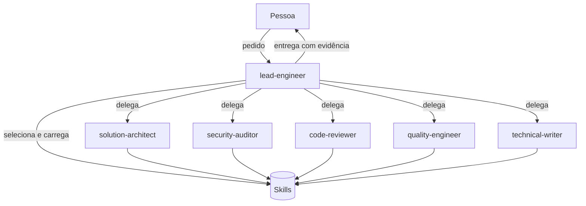

# Arquitetura do Prumo

Este documento explica como o repositório é organizado, por que foi organizado assim e como evolui.

## Visão geral

O Prumo tem três tipos de componente:

| Componente | O que é | Onde fica |
| --- | --- | --- |
| **Skill** | Conhecimento operacional sobre um tipo de trabalho: quando usar, fluxo, padrões, o que evitar e como verificar | `skills/<categoria>/<skill>/SKILL.md` |
| **Agente** | Um papel que combina skills para cumprir uma responsabilidade, com ferramentas e limites definidos | `agents/core/` e `agents/specialized/` |
| **Fluxo de trabalho** | A sequência de agentes e skills para um tipo de tarefa de ponta a ponta | `docs/workflows/` |

As skills não dependem dos agentes: cada uma funciona sozinha, carregada diretamente por qualquer ferramenta compatível. Os agentes dependem das skills e nunca duplicam o conteúdo delas.

## Princípios de desenho

1. **Método, não lista.** Cada skill descreve um fluxo executável e critérios de pronto verificáveis. Lista de boas práticas sem fluxo não entra.
2. **Uma skill por competência.** Duas skills para o mesmo problema geram instruções conflitantes e gastam contexto. Tecnologias só ganham skill própria (`stack-*`) quando têm convenções que mudam a forma de trabalhar.
3. **Divulgação progressiva.** A descrição decide o acionamento; o `SKILL.md` (até 200 linhas) orienta a execução; o detalhe fica em `references/`, aberto sob demanda.
4. **Evidência acima de confiança.** Toda skill termina em critérios verificáveis, e toda entrega passa por `delivery-verification`. Nenhum componente afirma o que não verificou.
5. **Dados que mudam são conferidos na fonte.** Versões, limites, preços e artigos de lei vêm acompanhados da instrução de consultar a fonte vigente.
6. **Menor privilégio.** Agentes de revisão e de auditoria não editam código. Ações destrutivas, irreversíveis ou externas exigem autorização.
7. **Sem dependências.** Os scripts usam apenas a biblioteca padrão do Node.js.

## Categorias de skills

| Categoria | Foco |
| --- | --- |
| `frontend` | Arquitetura de interface, acessibilidade, estado e dados no cliente |
| `backend` | Serviços, regras de negócio, persistência, autenticação e autorização |
| `security` | Código seguro, auditoria, modelagem de ameaças, privacidade e LGPD |
| `technical-documentation` | README, guias, ADRs, runbooks, diagramas |
| `api-integration` | Contratos REST e GraphQL, webhooks, integrações resilientes |
| `planning-architecture` | Requisitos, arquitetura, planejamento de implementação |
| `stacks-technologies` | Convenções de TypeScript/Node, React/Next.js, Python/Django, Git |
| `operations` | Esteira de entrega, observabilidade, performance |
| `ai-engineering` | Prompts e aplicações com modelos de linguagem |
| `productivity` | Economia de contexto e criação de skills |
| `ui-ux` | Design de interfaces e revisão de experiência |
| `software-engineering` | Qualidade de código, testes, revisão, depuração, verificação |

A lista completa, gerada a partir dos arquivos, está em [catalog.md](../catalog.md).

### Decisões de consolidação

Registro do que foi fundido de propósito, para evitar que seja separado sem motivo:

| Tema | Onde está | Motivo |
| --- | --- | --- |
| Clean Code, SOLID, padrões de projeto, refatoração | `code-quality` | São a mesma competência vista por ângulos diferentes |
| ADRs | `technical-writing` (modelo) e `system-architecture` (quando registrar) | Um ADR é um tipo de documento; a decisão em si é de arquitetura |
| PostgreSQL | Referência de `data-modeling` | Aplica o mesmo método de modelagem, com detalhes do banco |
| Autenticação e autorização | Referência de `backend-engineering` | Implementação pertence ao back-end; os controles estão em `secure-coding` |
| DevSecOps, Docker e CI/CD | `delivery-pipeline` | São partes da mesma esteira |
| Sistemas distribuídos e avaliação de tecnologias | Referências de `system-architecture` | Aprofundamentos usados só em parte dos casos |
| Landing pages, conversão, microinterações | `interface-design` e `ux-review` | Criar e avaliar são as duas competências; o tipo de página não justifica outra skill |
| Performance de front-end, back-end e banco | `performance-engineering` | O método de medição é o mesmo; as metas por camada ficam nas skills de área |

## Agentes

| Agente | Papel | Edita código de produto? |
| --- | --- | --- |
| `lead-engineer` | Coordena a tarefa de ponta a ponta e seleciona skills | Sim |
| `solution-architect` | Decisões estruturais, alternativas e ADRs | Não (apenas documentos de arquitetura) |
| `security-auditor` | Auditoria independente, somente leitura | Não |
| `code-reviewer` | Revisão independente de diff | Não |
| `quality-engineer` | Testes e verificação independente | Apenas testes |
| `technical-writer` | Documentação conferida contra o código | Apenas documentação |

### Seleção de skills

O `lead-engineer` contém uma tabela que relaciona sinais da tarefa a skills. O validador garante que **toda skill do repositório aparece nessa tabela**: uma skill nova não pode ser esquecida pelo agente principal. As regras de combinação limitam quantas skills são carregadas por etapa, para preservar contexto.

### Comunicação entre etapas

Agentes não compartilham memória. Cada etapa entrega um artefato (requisitos, desenho, plano, diff, apontamentos, relato de verificação) que a etapa seguinte consome. Ao delegar, o agente principal fornece objetivo, escopo, restrições e formato de retorno; ao receber, confere o resultado antes de repassá-lo.

## Formato e compatibilidade

- Skills seguem o formato aberto de Agent Skills: um diretório com `SKILL.md`, cujo frontmatter YAML tem apenas `name` e `description`. Isso mantém a compatibilidade com as ferramentas que adotam o formato.
- Agentes são arquivos Markdown com frontmatter (`name`, `description`, `tools`, `model`), no formato de subagentes do Claude Code. Em outras ferramentas, o corpo do arquivo pode ser usado como instrução de sistema.
- O repositório é também um plugin: `.claude-plugin/plugin.json` declara as categorias de skills e os arquivos de agentes.

## Idiomas

- **Identificadores** (nomes de skills, de agentes, de diretórios e de arquivos) são em inglês e estáveis. Eles não mudam com a tradução.
- **Conteúdo** é em português brasileiro nesta versão, com termos técnicos consagrados mantidos no original.
- **Versão em inglês (planejada):** as traduções ficarão em `i18n/en/`, espelhando a árvore de `skills/` e `agents/` com os mesmos identificadores. O validador passará a verificar a paridade entre os idiomas (mesmas skills, mesmas seções obrigatórias). O diretório será criado quando a primeira tradução existir.

## Automação

| Script | Função |
| --- | --- |
| `scripts/validate.mjs` | Valida skills, agentes, manifestos, links e catálogo; `--write-catalog` regenera `docs/catalog.md` |
| `scripts/install.mjs` | Copia skills e agentes selecionados para um diretório `.claude` |

A validação roda em todo push e pull request, pelo workflow em `.github/workflows/validate.yml`.

## Evolução

- **Adicionar skill:** siga a skill `skill-authoring` e o [padrão de skills](../standards/skill-standard.md).
- **Adicionar agente:** siga o [padrão de agentes](../standards/agent-standard.md).
- **Adicionar categoria:** crie o diretório, registre o título em `CATEGORY_TITLES` no validador e declare o caminho em `plugin.json`. Uma categoria precisa de pelo menos duas skills previstas.
- **Remover ou fundir:** registre no `CHANGELOG.md` como mudança incompatível, pois nomes de skills são interface pública.

Versionamento semântico: correção para ajustes de redação e de conteúdo; secundária para skills, agentes ou referências novos; principal para remoção, renomeação ou mudança de comportamento incompatível.
