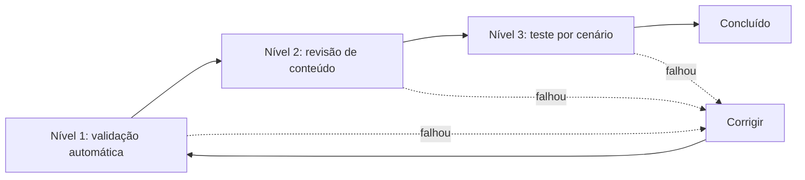

# Portão de qualidade

Uma skill ou um agente não está concluído porque o arquivo existe. Está concluído quando passa pelos três níveis abaixo, e o resultado de cada nível fica registrado no pull request.



## Nível 1: validação automática

```bash
node scripts/validate.mjs
```

Verifica estrutura, frontmatter, seções obrigatórias, tamanho, links, referências órfãs, nomes duplicados, coerência entre agentes e skills, manifestos do plugin e atualização do catálogo. O que é verificado está descrito no [padrão de skills](skill-standard.md) e no [padrão de agentes](agent-standard.md).

Critério: código de saída zero. Roda também na integração contínua a cada push e pull request.

**Limite deste nível:** comprova a forma, não a qualidade do conteúdo nem o comportamento.

## Nível 2: revisão de conteúdo

Leitura completa por alguém que não escreveu o texto (ou pelo autor, em sessão separada, lendo como leitor novo). Responda a cada item com sim ou não.

**Clareza**
- [ ] A descrição diz o que a skill faz e quando usar, com termos que um usuário empregaria.
- [ ] Cada passo do fluxo pode ser executado sem adivinhar o que o autor quis dizer.
- [ ] Os critérios de pronto são verificáveis com evidência.

**Valor**
- [ ] O conteúdo muda o que um agente competente faria sem a skill.
- [ ] Não há trechos genéricos que poderiam estar em qualquer skill.

**Redundância**
- [ ] O escopo não repete outra skill do [catálogo](../catalog.md).
- [ ] Não há repetição interna entre seções nem entre `SKILL.md` e referências.

**Veracidade**
- [ ] Comandos, trechos de código e exemplos foram executados ou conferidos na documentação oficial.
- [ ] Afirmações sobre versões, limites, normas e leis foram conferidas na fonte, ou trazem a instrução de conferir.
- [ ] Nada foi inventado: dados, métricas, citações, resultados.

**Economia**
- [ ] O `SKILL.md` contém só o que é necessário em toda execução; o restante está em `references/`.
- [ ] Não há introduções longas, repetições nem ênfase desnecessária.

**Segurança e autoria**
- [ ] Nenhuma instrução leva a ação destrutiva, a exposição de segredos ou a teste contra ambiente real sem autorização.
- [ ] O conteúdo é original e não menciona terceiros em sua identidade.

Critério: todos os itens em sim. Um item em não volta para correção.

## Nível 3: teste por cenário

Comprova que a skill produz o comportamento esperado em uso real.

1. **Escreva pelo menos três cenários** antes de finalizar o conteúdo:
   - dois pedidos realistas em que a skill deve atuar, de dificuldades diferentes;
   - um pedido próximo do tema em que a skill **não** deve ser acionada.
2. Para cada cenário, descreva o **comportamento esperado** como lista de itens observáveis (o que o agente deve fazer, perguntar, produzir ou recusar).
3. **Execute** cada cenário em uma sessão nova, com a skill instalada, sem dar dicas além do pedido.
4. **Compare** a execução com a lista e marque cada item como atendido ou não.
5. **Registre** no pull request: cenário, itens atendidos, itens não atendidos e a correção feita.
6. Após corrigir, **repita todos os cenários**: uma correção pode quebrar outro caso.

Modelos de cenário estão em [`examples/`](../../examples/README.md).

Critério: todos os itens esperados atendidos nos cenários de acionamento, e nenhum acionamento indevido no cenário negativo.

**Honestidade do registro:** informe apenas execuções que ocorreram. Cenário não executado é registrado como não executado.

### Agentes

Além dos cenários das skills que usa, um agente passa por:

- [ ] Um cenário de delegação: o agente principal identifica quando delegar a ele e fornece contexto suficiente.
- [ ] Um cenário de limite: diante de pedido fora do papel (por exemplo, pedir a um revisor que edite o código), o agente recusa e explica.
- [ ] A entrega segue o formato declarado, incluindo a seção de não verificado.

## Estado atual da validação

Para saber o que já foi validado em cada versão, consulte o `CHANGELOG.md`. Ele registra, por versão, quais níveis foram executados. Uma versão em que o nível 3 ainda não foi executado para todas as skills declara isso explicitamente.

## Auditoria periódica

A cada versão secundária:

1. Execute a validação automática.
2. Releia o catálogo procurando sobreposição entre skills.
3. Confira dados sujeitos a mudança (versões de normas, metas de mercado, recursos de plataformas).
4. Remova ou funda skills sem uso.
5. Registre o resultado no `CHANGELOG.md`.
