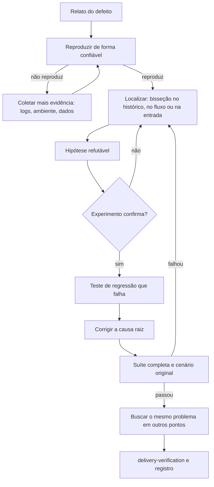

# Fluxo: correção de defeito

Para erros, regressões e comportamentos inesperados. A regra central é: nenhuma correção antes de entender a causa.

## Etapas

| # | Etapa | Responsável | Skills | Entrega |
| --- | --- | --- | --- | --- |
| 1 | Reproduzir | `lead-engineer` ou `quality-engineer` | `debugging` | Caso mínimo de reprodução |
| 2 | Diagnosticar | `lead-engineer` | `debugging`, `observability` (se faltar visibilidade) | Causa raiz com evidência |
| 3 | Proteger | `quality-engineer` | `testing-strategy` | Teste de regressão que falha |
| 4 | Corrigir | `lead-engineer` | Skill de área e de stack, `secure-coding` (se tocar entrada externa) | Menor mudança que resolve |
| 5 | Verificar | `lead-engineer` | `delivery-verification` | Relato com evidência |
| 6 | Integrar | `lead-engineer` | `git-workflow` | Commit `fix:` com a causa descrita |

## Critérios de saída

- O defeito foi reproduzido antes da correção.
- A causa raiz está explicada, com arquivo e linha.
- O teste de regressão falhava antes e passa depois.
- A suíte completa passa e o cenário original foi exercitado.
- Outras ocorrências do mesmo problema foram procuradas.
- A instrumentação temporária foi removida.

## Quando escalar

- Três hipóteses refutadas em sequência: reavalie as premissas antes de continuar.
- Várias correções falharam: o problema pode ser de desenho; envolva o `solution-architect`.
- A correção exige mudança incompatível, migração de dados ou acesso a produção: pare e peça autorização.
