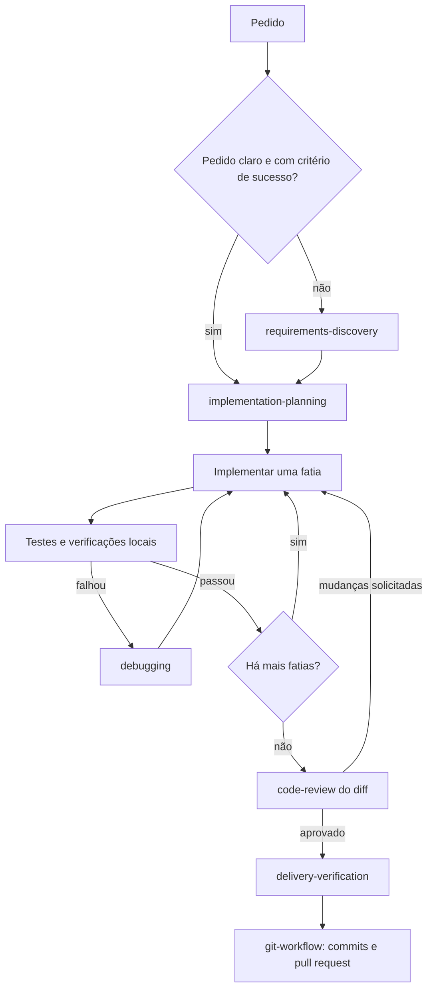

# Fluxo: entrega de funcionalidade

Para construir algo novo em um sistema existente, do pedido ao pull request.

## Etapas

| # | Etapa | Responsável | Skills | Entrega |
| --- | --- | --- | --- | --- |
| 1 | Entender | `lead-engineer` | `requirements-discovery` (se o pedido for vago) | Requisitos, critérios de aceite, escopo |
| 2 | Decidir a estrutura | `solution-architect` (se houver decisão estrutural) | `system-architecture`, `threat-modeling` | Desenho e ADR |
| 3 | Planejar | `lead-engineer` | `implementation-planning` | Plano em fatias verticais |
| 4 | Implementar | `lead-engineer` | Skill de área (`frontend-engineering`, `backend-engineering`, `data-modeling`, `api-design`), skill de stack, `secure-coding`, `testing-strategy` | Código e testes por fatia |
| 5 | Revisar | `code-reviewer` | `code-review` | Apontamentos e veredito |
| 6 | Verificar | `quality-engineer` ou `lead-engineer` | `delivery-verification` | Relato com evidência |
| 7 | Documentar | `technical-writer` (se a mudança afetar documentação) | `technical-writing` | Documentação atualizada |
| 8 | Integrar | `lead-engineer` | `git-workflow` | Commits e pull request |

## Critérios de saída

- Todos os critérios de aceite têm verificação executada.
- Suíte completa, tipos, lint e build passam.
- Nenhum apontamento crítico ou importante em aberto.
- Documentação e changelog acompanham a mudança.
- O que não foi verificado está declarado.

## Adaptação por tamanho

- **Pequena** (um arquivo, comportamento óbvio): etapas 1 e 3 em uma frase; 2 e 7 dispensadas; revisão como auto-revisão do diff.
- **Média**: fluxo completo sem a etapa 2, salvo decisão estrutural.
- **Grande**: fluxo completo; a etapa 4 é repetida por fatia, cada uma com sua verificação.
