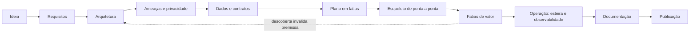

# Fluxo: projeto novo

Para sair de uma ideia e chegar a um sistema em produção, reduzindo o risco cedo e mantendo cada etapa verificável.

## Etapas

| # | Etapa | Responsável | Skills | Entrega |
| --- | --- | --- | --- | --- |
| 1 | Requisitos | `lead-engineer` | `requirements-discovery` | Problema, escopo, requisitos com critérios de aceite, viabilidade |
| 2 | Arquitetura | `solution-architect` | `system-architecture` | Desenho, trade-offs, ADRs |
| 3 | Riscos | `solution-architect` | `threat-modeling`, `privacy-lgpd` | Ameaças priorizadas, inventário de dados pessoais |
| 4 | Dados e contratos | `lead-engineer` | `data-modeling`, `api-design` | Esquema inicial e especificação da API |
| 5 | Plano | `lead-engineer` | `implementation-planning` | Fatias ordenadas por risco |
| 6 | Esqueleto | `lead-engineer` | Skills de stack, `delivery-pipeline` | Aplicação mínima que passa por todas as camadas, com pipeline rodando |
| 7 | Fatias | `lead-engineer`, `code-reviewer`, `quality-engineer` | Fluxo de [entrega de funcionalidade](feature-delivery.md) por fatia | Funcionalidades verificadas |
| 8 | Operação | `lead-engineer` | `observability`, `delivery-pipeline`, `performance-engineering` | Logs, métricas, alertas, reversão testada |
| 9 | Documentação | `technical-writer` | `technical-writing` | README, guia de execução, runbooks |
| 10 | Revisão final | `security-auditor`, `quality-engineer` | `security-review`, `delivery-verification` | Relatório de segurança e verificação da entrega |

## Princípios do fluxo

- **Esqueleto antes de profundidade.** A etapa 6 conecta interface, API, banco e pipeline com uma funcionalidade trivial. Problemas de integração aparecem na primeira semana, não na última.
- **Decisões irreversíveis recebem ADR.** As demais seguem o padrão e avançam.
- **Segurança e privacidade entram no desenho**, não em uma etapa final de correção.
- **O plano muda quando uma premissa cai.** A seta tracejada do diagrama é esperada, não é falha.
- **Publicar cedo, em ambiente de homologação**, com a esteira completa, antes de haver muita funcionalidade.

## Pontos de decisão do solicitante

O fluxo pausa para confirmação em:

1. Fim da etapa 1: escopo e prioridades.
2. Fim da etapa 2: decisões estruturais e custos.
3. Antes de qualquer criação de recurso externo, gasto ou publicação.

## Critérios de saída

- Requisitos essenciais atendidos, cada um com verificação executada.
- Esteira de entrega funcionando, com reversão exercitada.
- Observabilidade mínima: logs estruturados, métricas da jornada crítica, alerta com runbook.
- Auditoria de segurança sem achados críticos ou altos em aberto.
- Um novo integrante consegue rodar o projeto seguindo apenas o README.
