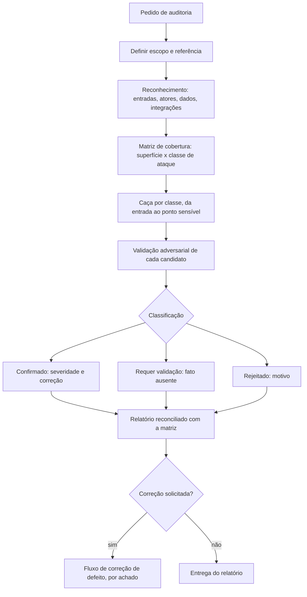

# Fluxo: auditoria de segurança

Para avaliar a segurança de um repositório, módulo ou diff. O fluxo é somente leitura: descreve correções, não as aplica sem pedido explícito.

## Etapas

| # | Etapa | Responsável | Skills | Entrega |
| --- | --- | --- | --- | --- |
| 1 | Delimitar | `lead-engineer` | `security-review` | Escopo, commit analisado, exclusões |
| 2 | Auditar | `security-auditor` | `security-review`, `secure-coding` | Achados classificados e matriz de cobertura |
| 3 | Avaliar privacidade | `security-auditor` (se houver dados pessoais) | `privacy-lgpd` | Inventário e lacunas |
| 4 | Conferir | `lead-engineer` | `security-review` | Achados conferidos no código, relatório reconciliado |
| 5 | Corrigir (opcional, com pedido explícito) | `lead-engineer` | `secure-coding`, `testing-strategy`, `delivery-verification` | Correção e teste de regressão por achado |

## Regras específicas

- Nenhum teste contra endpoint publicado, produção ou serviço de terceiros.
- Código do alvo não é executado fora de ambiente isolado; sem isolamento, o item fica como "requer validação".
- Segredos encontrados são citados por local e tipo, nunca reproduzidos.
- Severidade apenas para achados confirmados, e nunca acima do impacto demonstrado.
- Recomendações de fortalecimento ficam separadas dos achados.

## Critérios de saída

- Escopo, referência e limitações declarados.
- Cada achado confirmado tem caminho rastreado com arquivo e linha, impacto, correção e teste de regressão.
- A matriz de cobertura mostra o que foi examinado e o que não foi.
- A contagem do resumo coincide com as seções do relatório.
- Nenhum arquivo do alvo foi modificado durante a auditoria.
