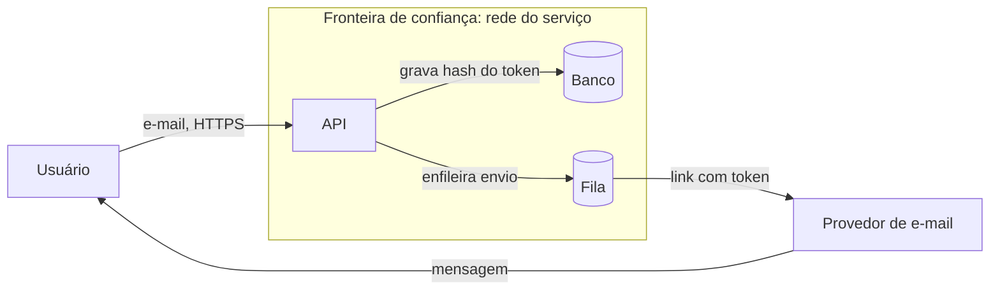

# Modelagem de Ameaças

Descobrir o que pode dar errado antes de construir, quando corrigir custa pouco. O resultado é uma lista priorizada de ameaças, cada uma com decisão registrada.

## Quando usar

- Novo sistema, novo serviço ou mudança de arquitetura.
- Funcionalidade que toca autenticação, pagamento, dados pessoais, upload ou multi-inquilino.
- Nova integração ou nova fronteira de rede.

Para auditar código já escrito, use `security-review`.

## As quatro perguntas

1. O que estamos construindo?
2. O que pode dar errado?
3. O que vamos fazer a respeito?
4. Fizemos um bom trabalho?

## Fluxo

1. **Delimite o escopo** e liste os ativos: o que tem valor para o negócio, para o usuário e para um atacante (dados pessoais, credenciais, saldo, disponibilidade, reputação).
2. **Desenhe o fluxo de dados** em Mermaid com: entidades externas, processos, armazenamentos, fluxos rotulados com o dado e o protocolo, e **fronteiras de confiança** onde o nível de privilégio muda.
3. **Liste as premissas** (por exemplo: "a rede interna não é confiável", "o provedor de identidade valida o segundo fator"). Premissa errada invalida o modelo.
4. **Identifique ameaças com STRIDE**, percorrendo cada elemento e cada fluxo que cruza uma fronteira:

   | Letra | Ameaça | Propriedade violada | Pergunta |
   | --- | --- | --- | --- |
   | S | Falsificação de identidade | Autenticidade | Alguém pode se passar por outro usuário ou serviço? |
   | T | Adulteração | Integridade | O dado pode ser alterado em trânsito ou em repouso? |
   | R | Repúdio | Não repúdio | Uma ação pode ser negada por falta de registro? |
   | I | Divulgação de informação | Confidencialidade | O dado pode ser lido por quem não deveria? |
   | D | Negação de serviço | Disponibilidade | O serviço pode ser esgotado ou travado? |
   | E | Elevação de privilégio | Autorização | Alguém pode fazer mais do que o permitido? |

5. **Acrescente casos de abuso do negócio**, que o STRIDE não revela: fraude, enumeração, raspagem, uso do produto fora do propósito, conluio entre contas.
6. **Priorize** cada ameaça por probabilidade (capacidade exigida, exposição) e impacto (dano ao ativo), em três níveis cada. Justifique em uma frase.
7. **Decida** para cada ameaça: mitigar (com controle específico), eliminar (remover a funcionalidade ou o dado), transferir (para terceiro, com contrato) ou aceitar (com responsável e justificativa).
8. **Converta mitigações em trabalho rastreável**: requisito, tarefa ou teste. Mitigação sem dono não existe.
9. **Valide**: toda fronteira do diagrama tem ameaças avaliadas; toda ameaça alta tem decisão; as premissas foram confirmadas com quem conhece o sistema.

## Padrões

- O modelo é versionado junto ao código e revisado quando a arquitetura muda.
- Uma ameaça é escrita como: "**Ator** pode **ação** por meio de **vetor**, resultando em **impacto** sobre **ativo**."
- Mitigações preferem controles preventivos; quando não for possível, detectivos com resposta definida.
- Riscos aceitos têm data de revisão.

## Evite

- Lista genérica de ameaças sem ligação com o diagrama.
- Modelo feito depois da implementação apenas para cumprir processo.
- Ignorar atores internos, contas comprometidas e a cadeia de fornecimento.
- Diagrama detalhado demais para ser lido ou abstrato demais para ser útil: o nível certo mostra cada fronteira.
- Mitigações vagas ("melhorar a segurança", "validar entradas").

## Critérios de pronto

- [ ] Diagrama com todas as fronteiras de confiança e fluxos rotulados.
- [ ] Ativos e premissas listados.
- [ ] Cada fluxo que cruza fronteira avaliado nas seis categorias.
- [ ] Toda ameaça tem prioridade justificada e decisão.
- [ ] Toda mitigação tem dono e forma de verificação.
- [ ] Riscos aceitos registrados com responsável.

## Exemplo

Funcionalidade: recuperação de senha por e-mail.

| Ameaça | STRIDE | Prob. | Impacto | Decisão |
| --- | --- | --- | --- | --- |
| Atacante descobre quais e-mails têm conta pela diferença de resposta | I | Alta | Média | Mitigar: resposta e tempo idênticos |
| Atacante adivinha o token | S | Baixa | Alta | Mitigar: 128 bits aleatórios, uso único, validade de 30 minutos |
| Vazamento do banco expõe tokens válidos | I | Baixa | Alta | Mitigar: armazenar apenas o hash |
| Inundação de pedidos para um e-mail | D | Média | Baixa | Mitigar: limite por conta e por origem |
| Token vaza por cabeçalho de referência na página de redefinição | I | Média | Alta | Mitigar: política de referência restritiva e página sem recursos de terceiros |

## Skills relacionadas

- `system-architecture` para o desenho que está sendo modelado.
- `secure-coding` para implementar as mitigações.
- `security-review` para verificar a implementação.
- `privacy-lgpd` quando os ativos incluem dados pessoais.
